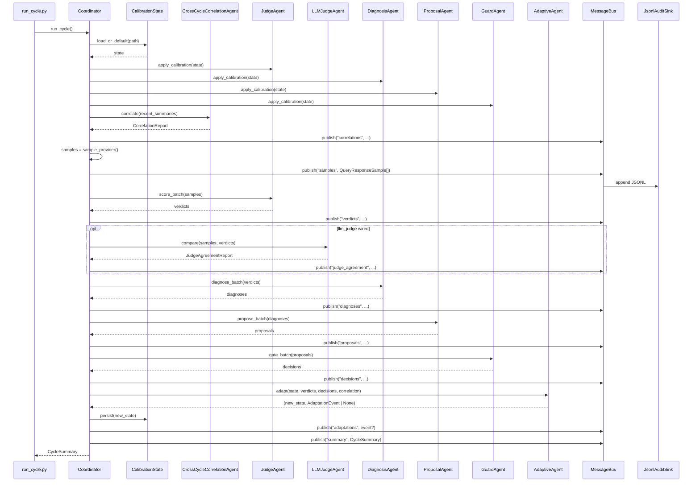

# Orchestration Boundaries — State Model, Control Flow, Extension Points

This document is the single-page contract for *how* ADCS orchestrates work
across its two coordination layers: the ingestion/publish pipeline
orchestrators and the continuous quality-improvement loop. It complements
[`quality-loop.md`](quality-loop.md), the narrative description of the
quality-improvement loop that runs alongside the serving stack (why each
agent exists, safety policy, operating mode).

Where that doc explains intent, this one fixes the explicit boundaries:
**state machines, the exact control-flow protocol, and the extension points
that future contributors are expected to use.** It is what reviewers should
diff against when adding a new agent, a new action, a new tunable, or a new
pipeline orchestrator.

---

## 1. State Models

ADCS exposes three distinct finite-state machines. Each is owned by exactly
one module and is the only place that may mutate the corresponding state.

### 1.1 Pipeline Operation FSM

Every long-running ingestion / publish operation transitions through a fixed
state machine, persisted via `FileSystemOperationStateStore`
([src/adcs/ingestion/operation_state_store.py](../src/adcs/ingestion/operation_state_store.py)).
The canonical enum is `SourceHugoNormalizationStatus`
([src/adcs/ingestion/source_hugo_normalization_orchestrator.py](../src/adcs/ingestion/source_hugo_normalization_orchestrator.py)):

```
                  ┌──────────┐
       trigger ──►│  QUEUED  │
                  └────┬─────┘
                       │ worker claim
                  ┌────▼─────┐
        ┌───────► │ RUNNING  │ ─────────────────┐
        │         └────┬─────┘                  │
        │              │                        │
        │  retriable   │ unrecoverable          │ user/api request
        │  failure     │ failure                ▼
        │         ┌────▼─────────────┐   ┌──────────────────┐
        │         │ RETRY_SCHEDULED  │   │ CANCEL_REQUESTED │
        │         └────┬─────────────┘   └────┬─────────────┘
        │              │ retry policy fires   │ worker observes
        └──────────────┘                      ▼
                       │              ┌──────────────┐
                       │              │  CANCELLED   │ (terminal)
                       │              └──────────────┘
                       │
              success  │  fatal
                  ┌────▼─────┐   ┌─────────┐
                  │COMPLETED │   │ FAILED  │ (terminal)
                  └──────────┘   └─────────┘
                    (terminal)
```

**Invariants:**

- `QUEUED → RUNNING` is the only entry into work.
- `RETRY_SCHEDULED` is reachable only from `RUNNING` and only via the
  orchestrator's retry policy (`retry_max_attempts`,
  `retry_backoff_base_seconds`, `retry_backoff_max_seconds`).
- `CANCEL_REQUESTED → CANCELLED` is the only cooperative-cancel path. A
  worker that has already started a non-idempotent stage **must** finish
  that stage atomically before observing the cancel.
- `COMPLETED`, `FAILED`, `CANCELLED` are terminal. No transition leaves a
  terminal state. Replays use a new `operation_id`.

Sister orchestrators (`source_sync_orchestrator.py`,
`source_layout_detection_orchestrator.py`) reuse the same state names but
own their own enums — there is no cross-orchestrator FSM. Cross-orchestrator
coordination happens through completed operation outputs, not shared state.

### 1.2 Quality-Loop Cycle FSM

The Coordinator runs exactly one cycle per invocation
(`Coordinator.run_cycle` in
[src/adcs/quality_loop/coordinator.py](../src/adcs/quality_loop/coordinator.py)).
Per-cycle state is in-memory only; cross-cycle state lives in
`CalibrationState`, the JSONL audit log, and the per-cycle `detail.json`
artefacts the `CrossCycleCorrelationAgent` reads at the start of the next
cycle.

```
  ┌──────────────────────┐
  │ load_calibration     │  (skipped if no calibration_state_path)
  └──────────┬───────────┘
             ▼
  ┌──────────────────────┐
  │ apply_to_agents      │  judge / diagnoser / proposer / guard
  └──────────┬───────────┘
             ▼
  ┌──────────────────────┐
  │ correlate            │  CrossCycleCorrelationAgent reads recent
  │                      │  CycleSummary[] → publish CorrelationReport
  │                      │  (default-on; threaded into adaptive.adapt
  │                      │   below so trends drive calibration)
  └──────────┬───────────┘
             ▼
  ┌──────────────────────┐
  │ pull_samples         │  via SampleProvider (synthetic or production)
  └──────────┬───────────┘
             ▼
  ┌──────────────────────┐
  │ judge.score_batch    │ → publish verdicts
  └──────────┬───────────┘
             ▼
  ┌──────────────────────┐
  │ llm_judge.compare    │ (skipped if no LLMJudgeAgent wired)
  │                      │ shadow LLM-judge runs against the same
  │                      │ samples; emits exactly one
  │                      │ JudgeAgreementReport per cycle. Does NOT
  │                      │ alter verdicts — purely for rubric review.
  └──────────┬───────────┘
             ▼
  ┌──────────────────────┐
  │ diagnoser.diagnose…  │ → publish diagnoses
  └──────────┬───────────┘
             ▼
  ┌──────────────────────┐
  │ proposer.propose…    │ → publish proposals
  └──────────┬───────────┘
             ▼
  ┌──────────────────────┐
  │ guard.gate_batch     │ → publish decisions
  └──────────┬───────────┘
             ▼
  ┌──────────────────────┐
  │ adaptive.adapt       │ (only if calibration_state_path set)
  │   ← correlation_report passed in so cross-cycle
  │     trends can drive proactive tightening
  │   → persist new      │ → publish AdaptationEvent (≤1)
  └──────────┬───────────┘
             ▼
  ┌──────────────────────┐
  │ persist_summary      │ → CycleSummary written
  └──────────────────────┘
```

The order is **fixed and non-configurable**. Reordering would void the
audit-log replay guarantee. The conditional steps are
`load_calibration` + `adaptive.adapt` (both gated on
`config.calibration_state_path is not None`), `correlate` (gated on
`coordinator.correlation is not None`; default-on with
`CrossCycleCorrelationAgent()`), and `llm_judge.compare` (gated on
`coordinator.llm_judge is not None`; off by default — only enabled when
a `LLMJudgeAgent` is explicitly injected). The correlate step's report
is fed into `adaptive.adapt` below so cross-cycle trends drive
calibration mutations; the LLM-judge step is **strictly read-only** —
it never alters the verdict batch the diagnoser sees.

### 1.3 Per-Proposal Guard FSM

For each `RemediationProposal`, the GuardAgent emits exactly one terminal
`GuardOutcome`. Outcomes are recorded in the audit log and consumed by the
AdaptiveAgent to drift `guard.auto_approve_blast_cap`.

```
proposal ─► GuardAgent.gate ─┬─► APPROVED            (safe + within cap)
                             ├─► NEEDS_HUMAN_APPROVAL (safe but policy-gated)
                             └─► REJECTED            (blast cap exceeded
                                                      or hard-policy block)
```

The three outcomes are **exhaustive and exclusive** — there is no fourth
state, and no proposal can be retried under a different outcome without a
new proposal with a fresh `proposal_id`.

---

## 2. Control Flow

### 2.1 One quality-loop cycle (message sequence)



Every published message is **also** appended to the JSONL audit log
(`reports/quality-loop/audit-log.jsonl` by default, written by
[scripts/quality_loop/run_cycle.py](../scripts/quality_loop/run_cycle.py))
with a stable `message_type` tag — the log is the single source of truth
for cross-cycle replay.

### 2.2 Failure paths

| Where it fails | Coordinator behaviour | Audit-log state |
|----------------|-----------------------|-----------------|
| `sample_provider()` raises | Cycle aborts; exception propagates | No `samples` published; no `CycleSummary` |
| Agent `*.batch()` raises | Cycle aborts mid-cycle | Partial messages persisted up to the failing agent |
| `CalibrationState.persist()` raises | Cycle aborts after `guard` but before summary | Decisions persisted; no `AdaptationEvent`, no summary |
| `JsonlAuditSink` write fails | Bus surface raises; cycle aborts | Disk-level failure — operator alert via filesystem health |

There is intentionally **no automatic retry inside a cycle**. Cycle failures
are surfaced to whatever scheduler invokes the cycle (for example an hourly
CI schedule); the next scheduled cycle is the recovery path. Inside a
single cycle, partial state is acceptable because the JSONL log makes the
exact point of failure replayable.

### 2.3 Pipeline orchestrator cancellation propagation

For ingestion orchestrators, cancellation is cooperative:

1. Admin API sets `status = CANCEL_REQUESTED` on the operation record.
2. Worker checks for a cancel request before processing each repository in
   the run (`_is_cancel_requested` in
   [source_hugo_normalization_orchestrator.py](../src/adcs/ingestion/source_hugo_normalization_orchestrator.py)).
3. On observation, worker flushes its current atomic stage, then transitions
   to `CANCELLED`.
4. No partial publish reaches the index; staged data remains in
   `data-*/_staging/` until cleanup.

A worker that misses the cancel signal (e.g., dies mid-stage) is recovered
by Celery's `acks_late=True`: the task is re-queued, sees
`CANCEL_REQUESTED`, and goes straight to `CANCELLED` without redoing work.

---

## 3. Extension Points

These are the **only** sanctioned ways to extend the orchestration layer.
Anything else is treated as a load-bearing change requiring an ADR
([docs/adr/](adr/README.md)).

### 3.1 Adding a new quality-loop agent

The Coordinator currently runs seven agents in fixed order:
`CrossCycleCorrelationAgent` (default-on, read-only) → `JudgeAgent` →
`LLMJudgeAgent` (optional shadow) → `DiagnosisAgent` → `ProposalAgent` →
`GuardAgent` → `AdaptiveAgent` (gated on calibration_state_path).
Adding an eighth requires:

1. **Implement the agent** in `src/adcs/quality_loop/<name>_agent.py`. It
   must expose `apply_calibration(...)` (even if a no-op) and a `*_batch`
   method that takes upstream messages and returns its own typed messages.
2. **Add the message type** to `src/adcs/quality_loop/models.py` with a
   stable `message_type` string. Append-only — never rename.
3. **Wire it into the Coordinator** in `Coordinator.run_cycle`
   ([src/adcs/quality_loop/coordinator.py](../src/adcs/quality_loop/coordinator.py))
   in the correct position relative to existing agents. The new position
   must be justified: agents may only consume messages emitted earlier in
   the same cycle.
4. **Add the publish step** with a new bus topic name. Never publish to an
   existing topic from a different agent.
5. **Update `CycleSummary`** in `src/adcs/quality_loop/models.py` to count
   the new agent's emissions.
6. **Add tests**: per-agent unit tests + an integration test that asserts
   the new emission appears in the JSONL log under the new topic.

Replacing or removing an existing agent is **forbidden** without a
versioned migration — downstream consumers of the audit log depend on
the topic set.

### 3.2 Adding a new ProposalAction

`ProposalAction` is an exhaustive enum in
[src/adcs/quality_loop/models.py](../src/adcs/quality_loop/models.py).
Adding one requires:

1. **Append** to the enum (never rename existing values).
2. **Classify** in `GuardAgent`: is it tracking (auto-approved) or mutating
   (queues for human)? The default for a new action is `NEEDS_HUMAN_APPROVAL`
   unless explicitly safe.
3. **Add a unit test** in `tests/quality_loop/test_guard_agent.py` that
   asserts the gating behaviour. The test failure is intentional friction
   if someone tries to add a mutating action with default approval.
4. **Document** in the safety policy table in
   [quality-loop.md](quality-loop.md#safety-policy-the-hard-invariants).

### 3.3 Adding a new calibration tunable

`CalibrationState` lives at
[src/adcs/quality_loop/calibration.py](../src/adcs/quality_loop/calibration.py).
A new tunable requires:

1. **Hard bounds** declared as constants. Bounds are non-calibratable.
2. **`apply_calibration` hook** on whichever agent consumes the tunable.
3. **A mutation rule** in the AdaptiveAgent with explicit priority relative
   to the existing four rules.
4. **A test invariant** that the tunable cannot exceed its hard bounds even
   under adversarial cycle outcomes.

The four currently-immutable safety controls
(`absolute_blast_cap`, `permit_auto_fusion_weight_adjust`,
`permit_auto_rollback`, `auto_approved_actions`) are **never** to be
calibratable. Removing this guarantee voids the loop's safety claim.

### 3.4 Adding a new pipeline orchestrator

The pattern is fixed; deviations need an ADR.

1. **Own its own status enum** (`StrEnum` with the seven canonical states:
   QUEUED, RUNNING, RETRY_SCHEDULED, CANCEL_REQUESTED, CANCELLED, FAILED,
   COMPLETED). Do **not** import another orchestrator's enum.
2. **Persist via `FileSystemOperationStateStore`** with an
   orchestrator-specific subdirectory under `state/`.
3. **Keyed by `operation_id`** (UUIDv4 or deterministic from inputs).
   Replaying with the same `operation_id` is a no-op if the previous run
   reached a terminal state.
4. **Register a Celery queue** in
   [src/adcs/worker/celery_app.py](../src/adcs/worker/celery_app.py)
   with `task_acks_late=True` and `worker_prefetch_multiplier=1`.
5. **Log structured progress** keyed by `operation_id`, with `product_id`,
   `language` and `version` where they apply, so an operation can be
   followed through the JSON logs.
6. **Add a runbook** under `infra/runbooks/` covering OOM, rate-limit,
   restore-from-partial-publish.

---

## 4. Things You Cannot Change Without a Versioned Migration

| Surface | Reason |
|---------|--------|
| `audit-log.jsonl` `message_type` strings | External replay tools key on them |
| The seven-agent fixed order in `Coordinator.run_cycle` | Audit-log replay assumes monotone causal order |
| Terminal pipeline-FSM states (`COMPLETED`, `FAILED`, `CANCELLED`) | Operator workflows + monitoring assume these are sinks |
| `operation_id` semantics (UUIDv4 or deterministic from inputs) | Idempotency guarantee depends on it |
| The four AdaptiveAgent non-tunables | The loop's safety claim depends on them |
| ProposalAction enum value strings | Downstream consumers depend on string stability |
| Bus topic names (`correlations`, `samples`, `verdicts`, `judge_agreement`, `diagnoses`, `proposals`, `decisions`, `adaptations`, `summary`) | External tools partition the log by topic; `audit_replay.replay_cycle()` keys on this set |

Anything in this table is a **versioned migration** with audit-log
back-compat shim, not an in-place change.

---

## 5. Related

- [quality-loop.md](quality-loop.md) — narrative architecture of the
  quality-improvement loop
- [src/adcs/quality_loop/coordinator.py](../src/adcs/quality_loop/coordinator.py) — single-cycle driver
- [src/adcs/quality_loop/models.py](../src/adcs/quality_loop/models.py) — message types, ProposalAction, CycleSummary
- [scripts/quality_loop/run_cycle.py](../scripts/quality_loop/run_cycle.py) — CLI entry point; writes the JSONL audit log (default `reports/quality-loop/audit-log.jsonl`)
- [adr/README.md](adr/README.md) — architecture decision records
